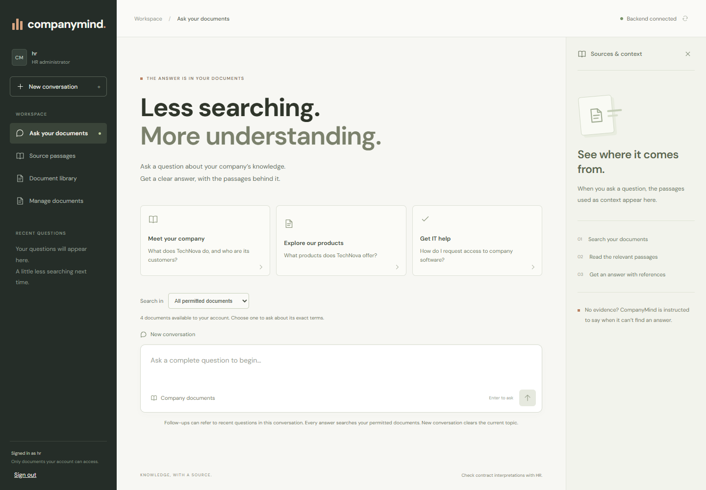
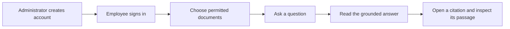
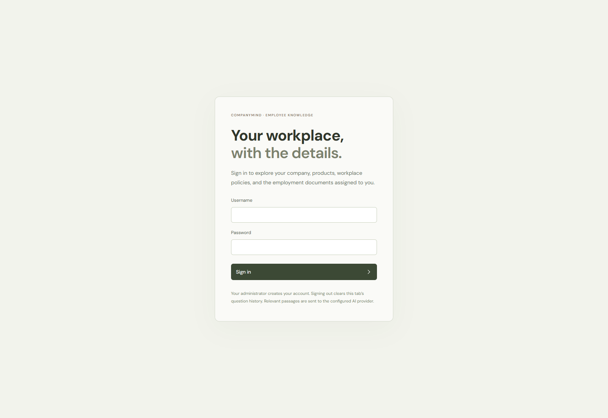
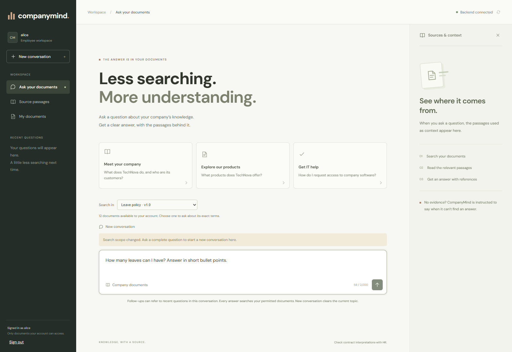
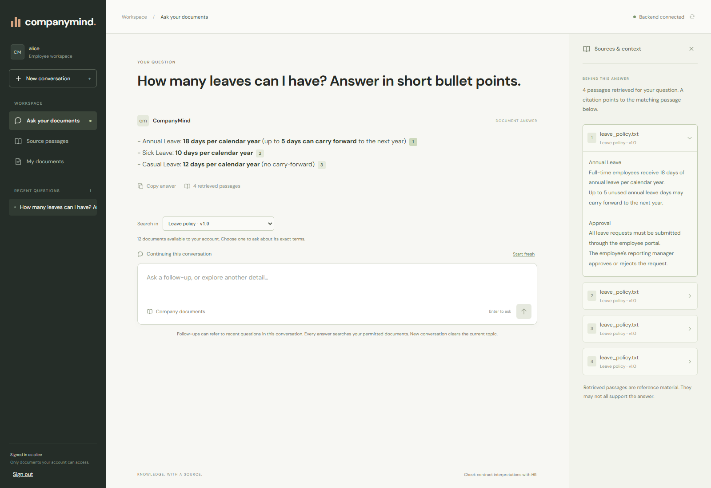
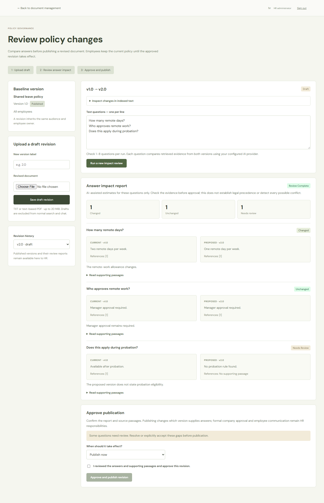
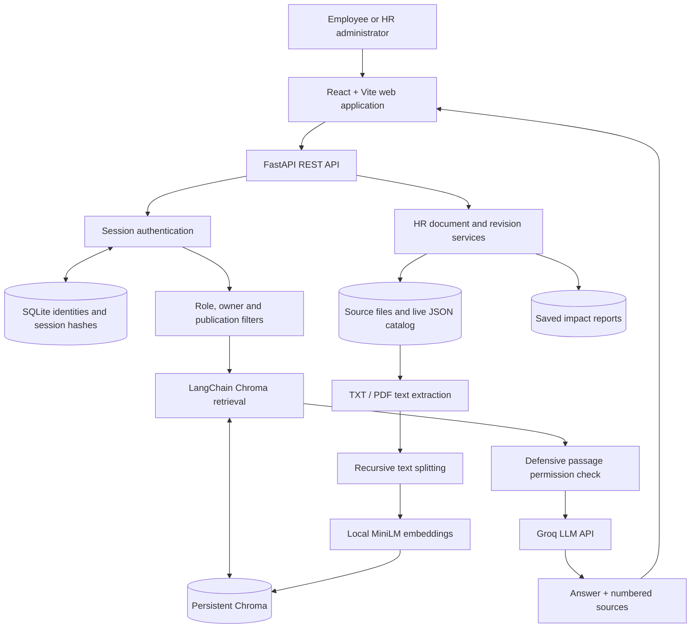
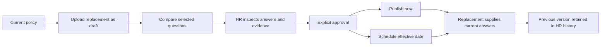

<div align="center">

# CompanyMind AI

### Company knowledge. Personal access. Answers with evidence.

A full-stack employee knowledge assistant with permission-aware RAG, private document access, and an HR workflow that previews how policy revisions could change employee answers.

**Python · FastAPI · React · LangChain · Chroma · Groq**

[Example flow](#from-sign-in-to-a-cited-answer) · [Features](#features) · [Policy impact review](#policy-change-impact-review) · [Architecture](#architecture) · [Run locally](#run-locally) · [Demo](#a-five-minute-demo) · [Engineering notes](#engineering-notes)

</div>

---

## Overview

Company information is spread across handbooks, HR policies, IT guides, offer letters and employment agreements. Employees need a clear answer, the document behind it, and confidence that private records stay private.

**CompanyMind brings those documents into one searchable assistant.** Employees ask questions in plain English and receive answers grounded in the passages they are allowed to access. HR can manage document audiences, upload replacements as drafts, compare answers across policy versions, and approve when a revision should take effect.

The project is a **production-oriented portfolio prototype for a single company**. It demonstrates an end-to-end GenAI product with real API integration and tested access boundaries. It is not presented as a certified enterprise deployment or an autonomous HR decision-maker.



*The application uses a beige and muted-green interface with clean, bold typography. Screenshots use isolated fictional demo accounts and documents.*

## From sign-in to a cited answer



**1. Sign in → 2. Ask a question**

| Sign in to CompanyMind | Alice selects the leave policy and asks a question |
|---|---|
|  |  |

Accounts are created by a trusted administrator through the setup or user-management command. The current app has a **sign-in screen**, not public self-service registration. Alice's document selection contains only shared policies and her assigned private documents.

**3. Read the answer and open its evidence**



In this example Alice asks, **“How many leaves can I have? Answer in short bullet points.”** The fictional leave policy specifies:

- **12 days of casual leave** per calendar year.
- **10 days of sick leave** per calendar year.
- **18 days of annual leave** per calendar year.

The answer includes clickable citations. Selecting one opens the corresponding passage in **Sources & context**, where Alice can check `leave_policy.txt`, its version and the actual policy text. These are policy entitlements, not a calculation of Alice's remaining balance after leave already taken.

*Captured from the running application with an isolated fictional Alice account, real MiniLM embeddings, Chroma retrieval and a live Groq response. The screenshots are not mockups; model wording may vary between runs.*

## Features

| Capability | What it does |
|---|---|
| **Document-grounded chat** | Retrieves relevant passages before generating an answer; the prompt instructs the model to acknowledge missing information. |
| **Evidence and citations** | Answers link to numbered passages with document titles, version labels, filenames and PDF page numbers where available. |
| **Employee-specific access** | Employees can search shared policies and their own assigned documents; another employee's private records are excluded. |
| **HR workspace** | HR can inspect classified documents, upload files, assign audiences and owners, and manage policy revisions. |
| **Document library** | Browse permitted documents, preview indexed passages and start a question scoped to a particular document. |
| **Follow-up questions** | Resolve short follow-ups using recent question context, then retrieve fresh evidence with current permissions. |
| **TXT and PDF ingestion** | Extract text, preserve source metadata, split into chunks, create local embeddings and store them in persistent Chroma. |
| **Policy impact review** | Compare current and proposed answers for selected questions before a replacement policy is published. |
| **Effective-date publication** | Publish immediately or schedule a revision; the old version stops supplying current answers at the cutover. |
| **REST API** | FastAPI endpoints and interactive OpenAPI documentation expose authentication, chat, retrieval and document administration. |

### Who can see what?

| Document audience | Alice | Bob | HR administrator |
|---|:---:|:---:|:---:|
| Shared company policy | Yes | Yes | Yes |
| Alice's private offer letter | Yes | No | Yes |
| Bob's private agreement | No | Yes | Yes |
| HR-only document | No | No | Yes |
| Unpublished policy draft | No | No | Dedicated HR review screen only |

Permissions are enforced **on the server before retrieval**, with a second check on returned passages before they reach the LLM. Hiding navigation buttons or asking the model to keep a secret is not the access-control mechanism.

## Policy-change impact review

The project's most distinctive workflow asks:

> **Before HR publishes a revised policy, how would the answers to these employee questions change?**

HR opens **Manage documents → Review policy revision**, uploads a replacement and runs 1–8 test questions. CompanyMind retrieves evidence separately from each version, generates paired answers and produces a review report.

| Example question | Current policy | Proposed policy | Result |
|---|---|---|---|
| How many remote days are allowed each week? | Two days | One day | **Changed** |
| Who approves remote work? | Reporting manager | Reporting manager | **Unchanged** |
| Is remote work available during probation? | Available only after probation | Not stated | **Needs review** |



*Illustrative report from the browser test environment. Deterministic test responses demonstrate the interface; live results depend on the supplied documents and model.*

### What makes this more than a file replacement?

- **Draft isolation:** proposed text is indexed for HR comparison but excluded from normal employee search and chat.
- **Evidence on both sides:** current and proposed answers have separate references, so HR can inspect the basis for a change.
- **Missing-information flags:** a missing supporting reference forces `Needs review`, rather than treating an omission as a confirmed new rule.
- **Stale-review protection:** hashes of metadata and indexed content bind a report to the versions reviewed. Changed evidence requires a fresh review before publication.
- **Explicit approval:** the latest completed report and HR acknowledgment are required to publish.
- **Audience inheritance:** a revision keeps the original document's audience and employee owner.
- **Time-based activation:** the old version's end time and replacement's start time share the same cutover.

This is **AI-assisted review of selected questions**, not a guarantee that every affected answer or policy conflict has been discovered. It does not decide legal precedence, send employee notices, or replace formal HR approval.

See the [policy revision walkthrough](docs/POLICY_REVISIONS.md), including fictional files you can upload yourself.

## Architecture



### The RAG pipeline

**Indexing:** document → extracted text → chunks with metadata → embeddings → Chroma.

**Answering:** authenticated question → optional follow-up rewrite → permission-filtered semantic search → passage validation → LLM answer → citations.

| Stage | Implementation |
|---|---|
| Text extraction | UTF-8 TXT and text-based PDFs through `pypdf`; PDF page metadata is retained. |
| Chunking | LangChain `RecursiveCharacterTextSplitter`: **300 characters**, **50-character overlap**, start offsets retained. |
| Embeddings | `sentence-transformers/all-MiniLM-L6-v2`, running locally on CPU with normalized embeddings. |
| Vector storage | Persistent Chroma collection: `company_documents_v2`. |
| Retrieval | Similarity search with server-derived audience, owner, staging and effective-date filters; optional document scope. |
| Generation | Groq API using `openai/gpt-oss-20b`, with document-grounding and citation instructions. |
| Conversation context | Bounded recent resolved questions; earlier assistant answers are not reused as factual evidence. |

**LangChain's role:** document objects, text splitting, Hugging Face embedding integration and the Chroma adapter. Application services own authentication, policy lifecycle and orchestration; this is not a claim of a LangChain agent implementation.

### Policy publication lifecycle



Scheduled activation uses `effective_from <= now < effective_until` during retrieval. It does not depend on a timer job firing at the right moment.

## Technology stack


| Layer | Technology |
|---|---|
| Backend | Python, FastAPI, Pydantic, Uvicorn |
| Frontend | React, Vite, CSS |
| RAG components | LangChain Core, Text Splitters, Hugging Face and Chroma integrations |
| Embeddings | Sentence Transformers / MiniLM |
| Vector database | Local persistent Chroma |
| LLM provider | Groq |
| Authentication storage | SQLite, salted scrypt password hashes, hashed opaque session tokens |
| Document storage | Local files and a runtime JSON catalog |
| Validation | pytest, real temporary Chroma integration tests, browser workflow checks, Oxlint and Vite build |

## Run locally

### Prerequisites

- Python **3.10+**; the project has been exercised on Windows with Python 3.10.
- Node.js **22.12+** and npm (the installed Vite version also supports Node 20.19+).
- Git and a **Groq API key**. Model calls are subject to the provider account's quota and availability.
- Internet access for the initial embedding-model download and LLM requests.

Chroma and embeddings run locally. **Local storage does not mean fully offline inference:** retrieved passages are sent to Groq when generating answers or reviewing policies.

### 1. Clone and install

These commands use Windows PowerShell:

```powershell
git clone https://github.com/AyushChoudhar5/CompanyMind-AI.git
cd CompanyMind-AI
python -m venv .venv
.\.venv\Scripts\Activate.ps1
python -m pip install -r backend/requirements.txt
```

On macOS/Linux, activate the environment with `source .venv/bin/activate`. Dependency installation and document processing have primarily been validated on Windows.

### 2. Configure the provider

Create a `.env` file in the repository root:

```dotenv
GROQ_API_KEY=your_groq_api_key_here
```

Keep this file local. Provider credentials never belong in frontend code or a public `VITE_` variable.

### 3. Create the fictional demo

```powershell
python -m backend.cli.manage setup-demo
```

Choose passwords of **12–128 characters** for `alice`, `bob` and `hr`. Nothing appears while typing; no default passwords are shipped. Existing account IDs retain their passwords. A fresh setup indexes **13 fictional sample documents**, covering shared company knowledge and private employment records.

### 4. Start the API

```powershell
python -m uvicorn backend.app.main:app --reload --host 127.0.0.1 --port 8000
```

Interactive API documentation: [http://127.0.0.1:8000/docs](http://127.0.0.1:8000/docs).

### 5. Start the frontend in a second terminal

```powershell
cd CompanyMind-AI/frontend
npm ci
npm run dev -- --host 127.0.0.1
```

Open [http://127.0.0.1:5173](http://127.0.0.1:5173) and sign in with a demo account. Adjust the `cd` path if your second terminal is already inside the repository.

<details>
<summary><strong>Port 8000 already in use?</strong></summary>

Start the backend with `--port 8001`. Before starting Vite, set its backend target:

```powershell
$env:COMPANYMIND_API_TARGET='http://127.0.0.1:8001'
npm run dev -- --host 127.0.0.1
```

The frontend and backend must agree on the port. A 404 at the API root `/` is not the same as a startup failure; use `/health` or `/docs`.

</details>

## A five-minute demo

1. **Ask a shared-policy question.** Sign in as Alice and ask: “How many casual leave days do employees receive?” Open the citation and inspect the passage.
2. **Check a missing answer.** Ask about something absent from the demo documents. Inspect whether the answer acknowledges the gap instead of inventing a policy.
3. **Show the permission boundary.** Open Alice's document library, then sign in as Bob. Their assigned private documents differ; HR can inspect both through its role.
4. **Continue a topic.** Ask about remote working, then “Does that apply during probation?” The system resolves the follow-up and performs a fresh permitted search.
5. **Review a policy change.** As HR, upload `examples/policy_revision/remote_work_v1.txt` as a separate demo policy. Upload `remote_work_v2.txt` through **Review policy revision**, then run the questions in `questions.txt`.
6. **Approve the replacement.** Inspect Changed / Unchanged / Needs review results and their passages, then publish or schedule the revision.

## API at a glance

| Route | Purpose | Access |
|---|---|---|
| `GET /health` | Process health, not LLM-provider readiness | Public |
| `POST /auth/login` | Exchange credentials for a bearer session | Public |
| `GET /auth/me` · `POST /auth/logout` | Resolve identity / revoke session | Signed in |
| `GET /documents` | List currently permitted documents | Signed in |
| `GET /documents/{id}/preview` | Preview indexed passages | Permitted document |
| `POST /search` · `POST /chat` | Retrieve evidence / generate an answer | Signed in |
| `DELETE /conversations/{id}` | Discard an owned conversation | Owning session |
| `GET /admin/employees` | List accounts for owner selection | HR |
| `GET /admin/documents` · `POST /admin/documents` | List / upload documents | HR |
| `DELETE /admin/documents/{id}` | Remove eligible documents from search and catalog | HR |
| `GET /admin/documents/{id}/revisions` · `POST /admin/documents/{id}/revisions` | List / upload draft revisions | HR |
| `GET /admin/revisions/{id}` | Revision details and latest report | HR |
| `POST /admin/revisions/{id}/review` | Start an impact review | HR |
| `POST /admin/revisions/{id}/publish` | Approve immediate or scheduled publication | HR |

Example authenticated `/chat` request body:

```json
{
  "question": "What is the remote working policy?",
  "top_k": 3
}
```

Send the token from `/auth/login` as `Authorization: Bearer <access_token>`. The response includes `answer`, `sources`, `truncated` and `conversation_id`. Pass that conversation ID with the next question to continue the topic. An optional `document_id` narrows retrieval; it never expands permissions.

## Engineering notes

- **Session security:** passwords use salted scrypt hashes; SQLite stores hashes of opaque bearer tokens. Sessions expire after one hour. The browser keeps credentials in memory, and logout revokes the session.
- **Layered access checks:** API identity is server-resolved. Retrieval applies metadata filters, then validates returned passages. Unknown roles and unclassified records are denied.
- **Controlled ingestion:** uploads accept TXT or text-based PDF, up to 20 MiB and 1,000 chunks. Server-generated filenames, owner validation and staging metadata limit accidental exposure during ingestion.
- **Fresh evidence for follow-ups:** memory retains up to four resolved questions, scoped to the session and document selection. It expires after 30 minutes of inactivity; it is not a cache of old answers used as truth.
- **Review validity:** publication checks the latest completed report against both policy versions' content and metadata signatures.
- **Failure handling:** catalog writes use file locking and atomic file replacement. Chroma and filesystem updates remain separate; rollback is best-effort, with reconciliation needed after some failures.

### Testing

From the repository root:

```powershell
python -m pip install -r backend/requirements-dev.txt
python -m pytest -q backend/tests
cd frontend
npm run lint
npm run build
```

The current backend suite passes **154 tests**. Backend tests use temporary SQLite databases, **real temporary Chroma collections**, deterministic embeddings and mocked generation. They cover employee isolation, session handling, scope bypass attempts, upload validation, draft visibility, scheduled cutover, stale reports, publication failures and model-reference validation.

The UI has also been exercised through local browser workflow checks using fictional accounts and a deterministic provider substitute. Those development checks are not currently packaged as a repository test runner. Separate live-provider smoke checks verified representative Changed / Unchanged / Needs review outputs; neither type of check is a quantitative RAG-quality benchmark.

## Project structure

```text
CompanyMind-AI/
├── backend/
│   ├── app/
│   │   ├── main.py                # FastAPI, auth/chat routes, application lifecycle
│   │   ├── core/                  # Identity, access, conversations, publication dates
│   │   ├── rag/                   # Ingestion, chunking, embeddings, retrieval, generation
│   │   └── documents/             # Libraries, uploads, revision review and publication
│   ├── cli/                       # Demo setup, indexing, user management, terminal chat
│   ├── tests/                     # Backend unit and integration tests
│   └── requirements.txt
├── frontend/src/                  # React chat, document workspaces and HR review UI
├── data/                          # Fictional seed documents and catalog
├── examples/policy_revision/      # Old/new demo policies and test questions
├── docs/                          # Guides, architecture notes and screenshots
├── runtime/                       # Local identities, live catalog and reports (ignored)
├── chroma_db/                     # Persistent local vectors (ignored)
└── .env                           # Local provider credentials (ignored)
```

## Current boundaries and next steps

The current version is intentionally a **single-company, single-process application**. It is useful for a portfolio demonstration and local experimentation, with these next steps remaining:

| Area | Current boundary / next step |
|---|---|
| Retrieval quality | Add a labelled evaluation set, then measure retrieval recall, citation support, groundedness, abstention, latency and cost before introducing hybrid search or reranking. |
| Background work | Reviews run one at a time in a process-local worker. Restarts interrupt active reviews. Add durable jobs and shared conversation storage before using multiple API workers. |
| Policy governance | Comparison covers selected questions and retrieved passages. Scheduled revisions cannot yet be cancelled in the UI. Formal approvals, notifications and broader conflict analysis remain separate work. |
| Document processing | No OCR for scanned PDFs. Complex tables require extraction review; production needs isolated processing, quotas and malware scanning. |
| Storage consistency | Chroma and catalog/files are not a distributed transaction. Backups, reconciliation, durable storage and stronger atomic activation are production work. |
| Identity and deployment | Add SSO/OIDC, HTTPS deployment, operational audit events, request limits, monitoring and a staging environment. No production-scale or compliance claim is made. |

Use fictional or approved redacted documents for demos. Employee permissions are enforced at the API boundary; people with direct access to Chroma or server files are outside that boundary. Offer letters and agreements are explained from supplied text, not assessed for legal enforceability.

## Further reading

- [Policy revision review and publication](docs/POLICY_REVISIONS.md)
- [Employee and HR access workspaces](docs/ACCESS_WORKSPACES.md)
- [Company knowledge and conversational RAG](docs/COMPANY_CHAT.md)
- [Learning guide](docs/LEARNING.md)
- [Code and folder guide](docs/PROJECT_STRUCTURE.md)

---

Built by [Ayush Choudhar](https://github.com/AyushChoudhar5) as an applied GenAI engineering project: from document ingestion and permission-aware retrieval to a usable employee interface and an evidence-based HR review workflow.
